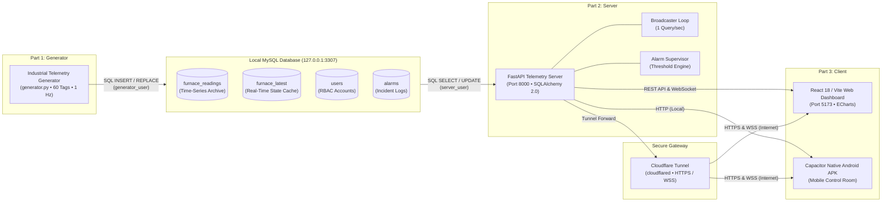

# Industrial Energy Intelligence Platform (IEIP)

A high-performance, real-time industrial telemetry, SCADA monitoring, and energy intelligence platform for heavy industrial furnaces, power distribution systems, and utilities.



---

## 3-Tier Architecture & Communication Contracts

| Tier | Component | Directory | Responsibility | Contract |
| :--- | :--- | :--- | :--- | :--- |
| **Tier 1** | **Telemetry Generator** | [`generator/`](file:///c:/Users/kusha/trends%20analysis/generator/) | Emits 60 industrial tags per second with bounded random walk and cumulative energy tracking. | Writes to `furnace_readings` and `furnace_latest` using `generator_user`. |
| **Database** | **Local MySQL** | [`db/`](file:///c:/Users/kusha/trends%20analysis/db/) | Relational time-series and state cache storage on `127.0.0.1:3307`. | [`db/schema.sql`](file:///c:/Users/kusha/trends%20analysis/db/schema.sql) & [`db/create_users.sql`](file:///c:/Users/kusha/trends%20analysis/db/create_users.sql). |
| **Tier 2** | **Backend Server** | [`server/`](file:///c:/Users/kusha/trends%20analysis/server/) | FastAPI REST & WebSocket backend, JWT authentication, downsampled SQL history, background alarm supervisor. | Exposes REST & WebSocket API on port 8000; never writes to readings tables. |
| **Tier 3** | **Client & Mobile APK** | [`client/`](file:///c:/Users/kusha/trends%20analysis/client/) | Industrial dark control-room UI (React 18 + TypeScript + Vite + Tailwind) and native Android APK. | Consumes REST + WebSocket API via [`client/src/config.ts`](file:///c:/Users/kusha/trends%20analysis/client/src/config.ts). |

---

## Network Ports & Exposure Rules

| Port | Service | Bound To | Exposure Rules |
| :--- | :--- | :--- | :--- |
| **3307** | MySQL Database | `127.0.0.1` | **NEVER exposed.** Localhost connection only. No remote root access. |
| **8000** | FastAPI Backend | `127.0.0.1` | Local development. Made public **ONLY** via Cloudflare Tunnel (`cloudflared`). |
| **5173** | Vite Dev Server | `127.0.0.1` | Local developer dashboard. Proxies `/api` to port 8000. |
| **HTTPS/WSS** | Cloudflare Public Gateway | Cloudflare Edge | Public encrypted entrypoint for mobile Android APK and remote browsers. |

---

## Quick Start & Operating Instructions

### 1. Initialize Database (First-Time Setup Only)
Initialize database tables and least-privilege users:
```cmd
scripts\init_database.bat
```
*(Prompts for root MySQL password; reads user credentials dynamically from `.env` files).*

### 2. Launch Platform Services
Start all three tiers (Generator, Server, and Client) concurrently in separate managed windows:
```cmd
scripts\start_all.bat
```
*Individual launchers are available in `scripts/`:*
- `scripts\start_generator.bat` — Emits 60 tags/sec to MySQL.
- `scripts\start_server.bat` — Starts FastAPI server on `http://127.0.0.1:8000`.
- `scripts\start_client.bat` — Starts Vite dev server on `http://127.0.0.1:5173`.
- `scripts\start_tunnel.bat` — Exposes port 8000 via Cloudflare Tunnel for remote/mobile access.

To stop all running services:
```cmd
scripts\stop_all.bat
```

---

## Testing & Quality Assurance

Run all automated unit and integration tests from the repository root:
```powershell
.\server\venv\Scripts\python.exe -m pytest -v
```

Run domain-specific test suites:
```powershell
.\server\venv\Scripts\python.exe -m pytest generator/tests
.\server\venv\Scripts\python.exe -m pytest server/tests
```

Run live system diagnostics:
- **Smoke Test**: `python scripts/smoke_test.py` (verifies live Generator -> MySQL -> Server telemetry pipeline)
- **WebSocket Monitor**: `python scripts/ws_client.py` (verifies live WebSocket broadcasts)

---

## Documentation

Detailed documentation is available in the [`docs/`](file:///c:/Users/kusha/trends%20analysis/docs/) directory:
- [Architecture & Design](file:///c:/Users/kusha/trends%20analysis/docs/architecture.md): Deep dive into data pipelines, tag dictionaries, and database schemas.
- [API Reference](file:///c:/Users/kusha/trends%20analysis/docs/api.md): Complete REST & WebSocket API endpoint documentation.
- [Operational Runbook](file:///c:/Users/kusha/trends%20analysis/docs/runbook.md): Deployment, maintenance, data retention pruning, and Android APK builds.
