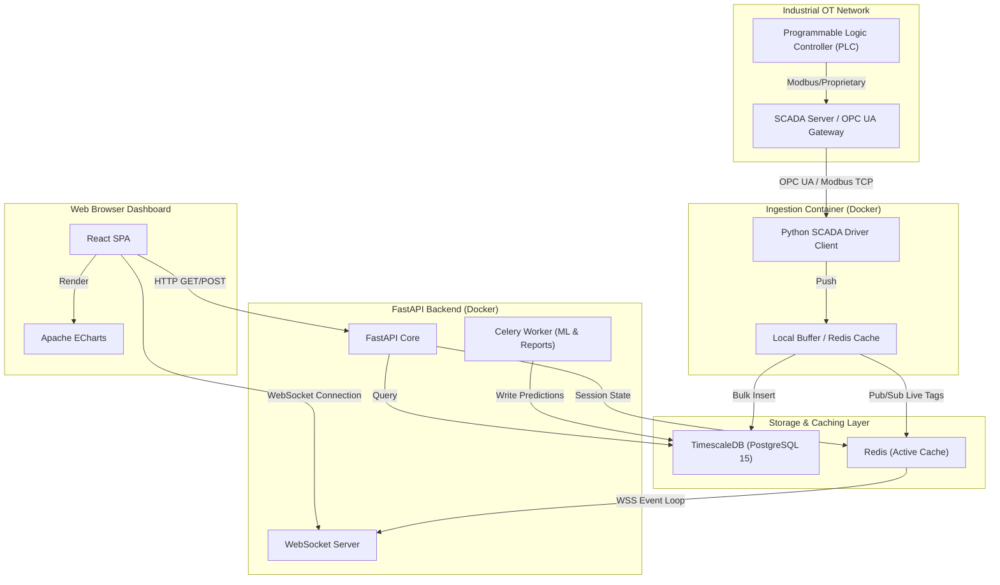
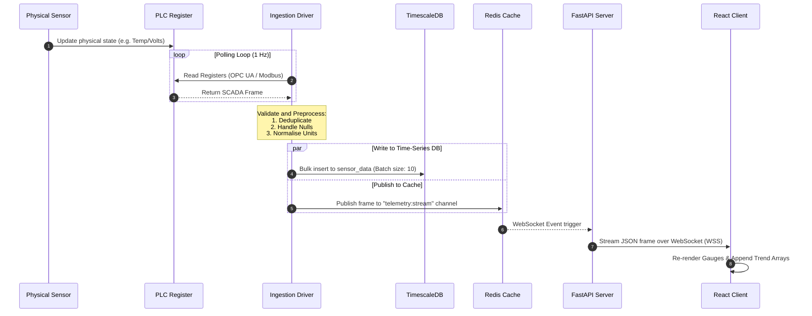
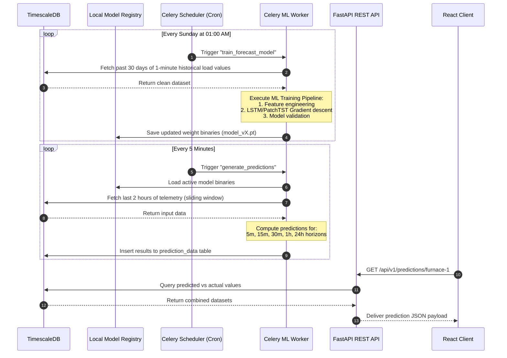

# System Architecture Design Document
## Real-Time Industrial Furnace Data Analytics and Trend Prediction System Using SCADA Data

---

### 1. Architectural Summary

The System is structured as a **Layered Service Architecture** with event-driven streaming components and asynchronous machine learning workers. The system is divided into logical layers to isolate real-time data ingestion, time-series storage, analytical execution, REST services, and web rendering. This separation prevents database-heavy queries or machine learning training sessions from degrading the reliability of real-time telemetry ingestion.

---

### 2. Logical Architecture Layers

The architecture consists of six sequential layers:

```
┌────────────────────────────────────────────────────────────────────────┐
│                        1. SCADA INGESTION LAYER                        │
│   (OPC UA / Modbus TCP / MQTT Drivers) ──> Real-Time Raw Sensor Stream  │
└───────────────────────────────────┬────────────────────────────────────┘
                                    ▼
┌────────────────────────────────────────────────────────────────────────┐
│                      2. PREPROCESSING & VALIDATION                     │
│   (Missing Value Imputation, Deduplication, Physical Range Checking)   │
└───────────────────────────────────┬────────────────────────────────────┘
                                    ▼
┌────────────────────────────────────────────────────────────────────────┐
│                       3. TIME-SERIES DATA STORE                        │
│         (TimescaleDB Hypertables & Redis Real-Time Cache)             │
└───────────────────────────────────┬────────────────────────────────────┘
                                    ▼
┌────────────────────────────────────────────────────────────────────────┐
│                 4. ANALYTICS, KPI & FORECASTING ENGINE                 │
│  (Statistical Rollups, Z-score Anomalies, PyTorch LSTM / PatchTST)     │
└───────────────────────────────────┬────────────────────────────────────┘
                                    ▼
┌────────────────────────────────────────────────────────────────────────┐
│                      5. APPLICATION SERVING LAYER                      │
│        (FastAPI REST Gateways, WebSocket Streams, Webhook Router)      │
└───────────────────────────────────┬────────────────────────────────────┘
                                    ▼
┌────────────────────────────────────────────────────────────────────────┐
│                       6. VISUALIZATION SYSTEM                          │
│               (React, TypeScript, Apache ECharts Client)              │
└────────────────────────────────────────────────────────────────────────┘
```

---

### 3. Component & Flow Diagrams

#### 3.1 Logical Component Diagram
The diagram below details the boundary separation of the system components and their communication channels:



#### 3.2 Live Telemetry Sequence Diagram
The sequence diagram below represents the millisecond-latency path of a sensor tag value from the physical sensor to the operator's browser:



#### 3.3 Asynchronous Machine Learning Lifecycle
The machine learning forecasting and deep-learning prediction pipeline runs detached from the main telemetry loop to ensure API responsiveness:



---

### 4. Component Breakdown & Microservices

#### 4.1 SCADA Driver Client Service
* **Purpose**: Establish communication with PLC registers or OPC UA namespaces.
* **Mechanism**: Runs as a daemon inside a lightweight Docker container. It initiates read loops, formats PLC raw bytes into JSON packets with structural schema validation, and routes it to the Database/Caching system.
* **Failover**: Utilizes a local SQLite buffer on the container's disk to cache incoming events if the main network switch or database instance goes down.

#### 4.2 Stream Preprocessing Service
* **Purpose**: Filter, cleanse, and structure sensor streams before persistence.
* **Operations**: Implements range checks, flags missing values using interpolation coefficients, and structures values under clean canonical names (e.g., `grid_voltage`, `power_factor`).

#### 4.3 Serving Layer (FastAPI Core)
* **Purpose**: Manage client requests and stream telemetry.
* **Mechanisms**: 
  * REST API points using async connections to PostgreSQL.
  * Native Python asyncio events to tail Redis Pub/Sub channels and pump variables to active WebSocket connections.

#### 4.4 ML Inference & Job Worker (Celery / Redis Broker)
* **Purpose**: Offload computational workload.
* **Mechanisms**: Runs background processes to run Z-score rolling windows, execute inference calculations, compile PDFs, and perform model retraining.

---

### 5. Machine Learning & Anomaly Detection Pipeline

```
┌─────────────────┐      ┌─────────────────┐      ┌─────────────────┐
│ Historical Data │ ───> │ Preprocessing & │ ───> │     Feature     │
│  (TimescaleDB)  │      │ Resampling (1m) │      │   Engineering   │
└─────────────────┘      └─────────────────┘      └────────┬────────┘
                                                           │
                                                           ▼
┌─────────────────┐      ┌─────────────────┐      ┌─────────────────┐
│ Real-Time API   │ <─── │ Model Registry  │ <─── │  Model Training │
│   Serving Layer │      │ (.pt / .pkl)    │      │  & Validation   │
└─────────────────┘      └─────────────────┘      └─────────────────┘
```

1. **Extraction**: Raw time-series points are pulled and downsampled to 1-minute intervals.
2. **Preprocessing**: Missing values are forward-filled, and inputs are normalized using Z-score scaling.
3. **Feature Engineering**: Features include lagged inputs ($t-1$, $t-5$, $t-15$, $t-60$ minutes), rolling average loads, time-of-day sine/cosine encoding, and active/reactive power metrics.
4. **Model Architecture**:
   * **Base Model**: Long Short-Term Memory (LSTM) network capturing sequential dependencies.
   * **Advanced Model**: PatchTST (Patch Time Series Transformer) for longer forecasting horizons.
5. **Model Registry**: Validated models are serialized to disk (`.pt` or `.pkl`) with metadata detailing training accuracy, epoch count, loss metrics, and feature configurations.

---

### 6. Technology Stack Rationale

| Layer | Selected Tech | Rationale & Trade-offs |
| :--- | :--- | :--- |
| **Backend Framework** | **FastAPI** | Extremely low latency, built-in support for asynchronous processes (async/await), automatic Swagger/OpenAPI documentation generation, and native WebSocket handling. |
| **Database** | **TimescaleDB** | Built on PostgreSQL, offering SQL support along with time-series hypertable performance. Automatically partitions data by time. |
| **Cache & Pub/Sub** | **Redis** | In-memory storage. Serves as a message broker for WebSocket updates and a celery queue manager. |
| **Frontend Framework** | **React + TS** | Type-safe React builds for dashboard reliability. Component-driven layout enables real-time virtual DOM updates. |
| **Charts** | **Apache ECharts** | Canvas/SVG rendering engine capable of displaying tens of thousands of data points smoothly without lagging the browser tab. |
| **Deployment** | **Docker Compose** | Simplifies setting up multiple services (FastAPI, Redis, DB, React, Drivers) in isolated containers with unified configuration files. |
