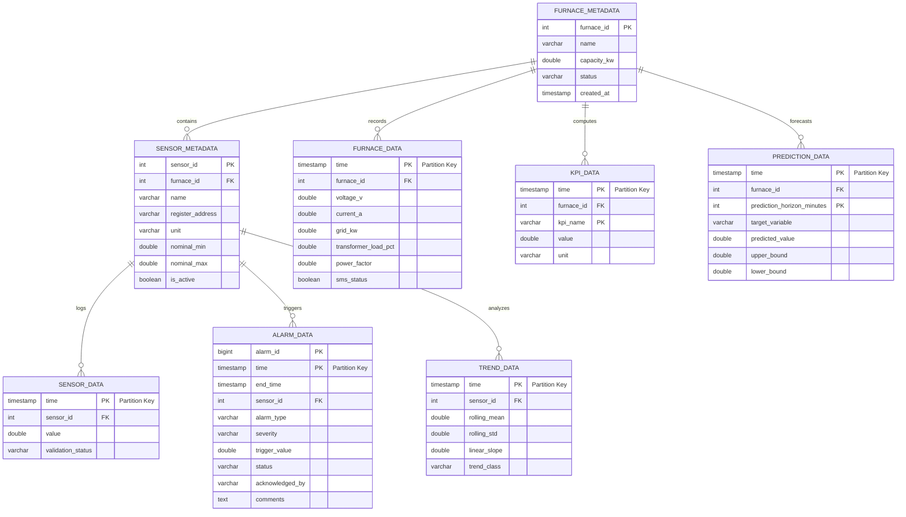

# Database Design Document
## Real-Time Industrial Furnace Data Analytics and Trend Prediction System Using SCADA Data

---

### 1. Database Overview

The system uses **TimescaleDB**, a time-series extension built on top of **PostgreSQL 15**. TimescaleDB handles the high-volume streaming telemetry, while standard PostgreSQL relational tables manage system metadata, user privileges, and alarm states. 

#### 1.1 Core TimescaleDB Features Utilized
* **Hypertables**: Tables that are automatically partitioned by time (and optionally by a partition key like `sensor_id`). This ensures insert performance remains high even as tables grow to billions of rows.
* **Continuous Aggregates**: TimescaleDB’s version of materialized views that update automatically as new raw time-series data is written. Used to compute hourly and daily rolling averages.
* **Native Compression**: Compresses historical rows on a column-oriented layout, reducing storage footprints by up to 90% while allowing direct query execution.
* **Retention Policies**: Automates the purging of raw sensor data after a specified window (90 days).

---

### 2. Entity Relationship Diagram (ERD)

The database schema is split between time-series metrics (hypertables) and relation metadata.



---

### 3. SQL Schema Definitions (DDL)

The scripts below initialize the database schema and convert time-series tables into hypertables.

```sql
-- Enable TimescaleDB extension
CREATE EXTENSION IF NOT EXISTS timescaledb CASCADE;

-- -----------------------------------------------------
-- Metadata Tables (Standard Relational Tables)
-- -----------------------------------------------------

CREATE TABLE furnace_metadata (
    furnace_id SERIAL PRIMARY KEY,
    name VARCHAR(100) NOT NULL UNIQUE,
    capacity_kw DOUBLE PRECISION NOT NULL,
    status VARCHAR(20) DEFAULT 'ACTIVE' CHECK (status IN ('ACTIVE', 'MAINTENANCE', 'INACTIVE')),
    created_at TIMESTAMP WITH TIME ZONE DEFAULT CURRENT_TIMESTAMP
);

CREATE TABLE sensor_metadata (
    sensor_id SERIAL PRIMARY KEY,
    furnace_id INTEGER REFERENCES furnace_metadata(furnace_id) ON DELETE CASCADE,
    name VARCHAR(100) NOT NULL,
    register_address VARCHAR(50) NOT NULL,
    unit VARCHAR(20) NOT NULL,
    nominal_min DOUBLE PRECISION,
    nominal_max DOUBLE PRECISION,
    is_active BOOLEAN DEFAULT TRUE,
    created_at TIMESTAMP WITH TIME ZONE DEFAULT CURRENT_TIMESTAMP,
    CONSTRAINT unique_furnace_sensor_name UNIQUE (furnace_id, name)
);

-- -----------------------------------------------------
-- Hypertables (Time-Series Data Tables)
-- -----------------------------------------------------

CREATE TABLE sensor_data (
    time TIMESTAMP WITH TIME ZONE NOT NULL,
    sensor_id INTEGER REFERENCES sensor_metadata(sensor_id) ON DELETE CASCADE,
    value DOUBLE PRECISION NOT NULL,
    validation_status VARCHAR(15) DEFAULT 'VALID' CHECK (validation_status IN ('VALID', 'INVALID', 'SUSPECT', 'IMPUTED'))
);

CREATE TABLE furnace_data (
    time TIMESTAMP WITH TIME ZONE NOT NULL,
    furnace_id INTEGER REFERENCES furnace_metadata(furnace_id) ON DELETE CASCADE,
    voltage_v DOUBLE PRECISION NOT NULL,
    current_a DOUBLE PRECISION NOT NULL,
    grid_kw DOUBLE PRECISION NOT NULL,
    transformer_load_pct DOUBLE PRECISION NOT NULL,
    power_factor DOUBLE PRECISION NOT NULL,
    sms_status BOOLEAN DEFAULT FALSE
);

CREATE TABLE alarm_data (
    alarm_id BIGSERIAL,
    time TIMESTAMP WITH TIME ZONE NOT NULL,
    end_time TIMESTAMP WITH TIME ZONE,
    sensor_id INTEGER REFERENCES sensor_metadata(sensor_id) ON DELETE CASCADE,
    alarm_type VARCHAR(50) NOT NULL,
    severity VARCHAR(15) NOT NULL CHECK (severity IN ('INFO', 'WARNING', 'CRITICAL')),
    trigger_value DOUBLE PRECISION,
    status VARCHAR(20) DEFAULT 'ACTIVE' CHECK (status IN ('ACTIVE', 'ACKNOWLEDGED', 'CLEARED')),
    acknowledged_by VARCHAR(50),
    comments TEXT,
    PRIMARY KEY (alarm_id, time)
);

CREATE TABLE trend_data (
    time TIMESTAMP WITH TIME ZONE NOT NULL,
    sensor_id INTEGER REFERENCES sensor_metadata(sensor_id) ON DELETE CASCADE,
    rolling_mean DOUBLE PRECISION NOT NULL,
    rolling_std DOUBLE PRECISION NOT NULL,
    linear_slope DOUBLE PRECISION NOT NULL,
    trend_class VARCHAR(15) DEFAULT 'STABLE' CHECK (trend_class IN ('RISING', 'STABLE', 'FALLING'))
);

CREATE TABLE prediction_data (
    time TIMESTAMP WITH TIME ZONE NOT NULL,
    furnace_id INTEGER REFERENCES furnace_metadata(furnace_id) ON DELETE CASCADE,
    prediction_horizon_minutes INTEGER NOT NULL,
    target_variable VARCHAR(50) NOT NULL,
    predicted_value DOUBLE PRECISION NOT NULL,
    upper_bound DOUBLE PRECISION,
    lower_bound DOUBLE PRECISION,
    PRIMARY KEY (time, furnace_id, prediction_horizon_minutes, target_variable)
);

CREATE TABLE kpi_data (
    time TIMESTAMP WITH TIME ZONE NOT NULL,
    furnace_id INTEGER REFERENCES furnace_metadata(furnace_id) ON DELETE CASCADE,
    kpi_name VARCHAR(50) NOT NULL,
    value DOUBLE PRECISION NOT NULL,
    unit VARCHAR(20) NOT NULL,
    PRIMARY KEY (time, furnace_id, kpi_name)
);

-- -----------------------------------------------------
-- Convert Time-Series Tables to Hypertables
-- -----------------------------------------------------

SELECT create_hypertable('sensor_data', 'time', chunk_time_interval => INTERVAL '1 day');
SELECT create_hypertable('furnace_data', 'time', chunk_time_interval => INTERVAL '1 day');
SELECT create_hypertable('alarm_data', 'time', chunk_time_interval => INTERVAL '7 days');
SELECT create_hypertable('trend_data', 'time', chunk_time_interval => INTERVAL '1 day');
SELECT create_hypertable('prediction_data', 'time', chunk_time_interval => INTERVAL '7 days');
SELECT create_hypertable('kpi_data', 'time', chunk_time_interval => INTERVAL '30 days');
```

---

### 4. Partitioning & Compression Policies

Time-series partitions (chunks) are configured based on data ingestion volume. For 1 Hz telemetry across multiple registers, `1 day` chunk intervals optimize memory limits by keeping active data tables in RAM.

#### 4.1 Indexing Strategy
To optimize time-series queries (which typically filter by a component ID and a recent time range), composite indexes are configured on time-descending sequence:

```sql
-- Indexes for Sensor Data
CREATE INDEX idx_sensor_data_sensor_time ON sensor_data (sensor_id, time DESC);

-- Indexes for Furnace Data
CREATE INDEX idx_furnace_data_furnace_time ON furnace_data (furnace_id, time DESC);

-- Indexes for Anomaly and Alarms
CREATE INDEX idx_alarm_data_status ON alarm_data (status, severity);
CREATE INDEX idx_alarm_data_sensor_time ON alarm_data (sensor_id, time DESC);

-- Indexes for ML Predictions
CREATE INDEX idx_prediction_lookup ON prediction_data (furnace_id, target_variable, time DESC);
```

#### 4.2 Compression Configuration
Data older than 7 days is compressed using TimescaleDB column-oriented encoding. This converts row segments into arrays, reducing storage space.

```sql
-- Enable compression on sensor_data
ALTER TABLE sensor_data SET (
    timescaledb.compress,
    timescaledb.compress_segmentby = 'sensor_id',
    timescaledb.compress_orderby = 'time DESC'
);

-- Enable compression on furnace_data
ALTER TABLE furnace_data SET (
    timescaledb.compress,
    timescaledb.compress_segmentby = 'furnace_id',
    timescaledb.compress_orderby = 'time DESC'
);

-- Set automated compression policy (compress after 7 days)
SELECT add_compression_policy('sensor_data', INTERVAL '7 days');
SELECT add_compression_policy('furnace_data', INTERVAL '7 days');
```

#### 4.3 Retention Configuration
To prevent disk exhaustion, raw data partitions are dropped after 90 days. Aggregated historical views and reports remain preserved in the `kpi_data` table indefinitely.

```sql
-- Configure retention policy for raw sensor data (90 days)
SELECT add_retention_policy('sensor_data', INTERVAL '90 days');
SELECT add_retention_policy('furnace_data', INTERVAL '90 days');
```

---

### 5. Continuous Aggregates (Materialized Aggregations)

To serve long-term analytics without scanning millions of raw rows, continuous aggregate views automatically summarize data.

```sql
-- Hourly Continuous Aggregate for Sensor Readings
CREATE MATERIALIZED VIEW sensor_data_hourly
WITH (timescaledb.continuous) AS
SELECT 
    time_bucket('1 hour', time) AS bucket,
    sensor_id,
    avg(value) AS avg_value,
    max(value) AS max_value,
    min(value) AS min_value,
    stddev(value) AS stddev_value
FROM sensor_data
GROUP BY bucket, sensor_id;

-- Set update policy for hourly aggregate (runs every hour, checks past 3 hours of updates)
SELECT add_continuous_aggregate_policy('sensor_data_hourly',
    start_offset => INTERVAL '3 hours',
    end_offset => INTERVAL '1 hour',
    schedule_interval => INTERVAL '1 hour');
```
